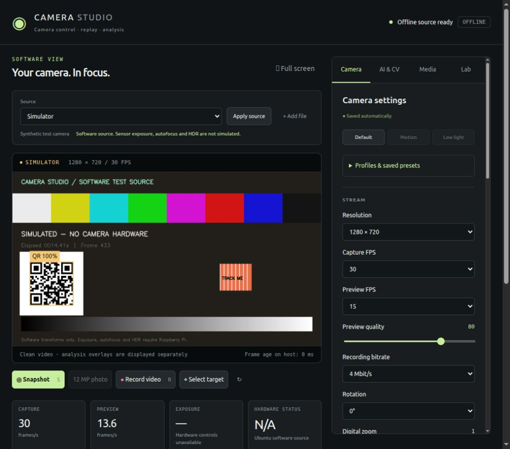

# CameraDrone / Camera Studio

An English-language camera control application for an Ubuntu host and a Raspberry Pi CSI camera. Develop and test the application **without a Raspberry Pi** using a synthetic camera or recorded inputs. Capture, ISP and inference run on the Pi when a real camera is selected; offline processing runs on Ubuntu.



## Start without hardware

On Ubuntu 22.04 with Python 3.10 or newer:

```bash
sudo apt-get update
sudo apt-get install -y python3-venv gstreamer1.0-tools gstreamer1.0-plugins-base gstreamer1.0-plugins-good gstreamer1.0-plugins-bad gstreamer1.0-plugins-ugly gstreamer1.0-libav
python3 -m venv .venv
.venv/bin/pip install -r requirements-host.txt
.venv/bin/python camera_app/fetch_models.py
.venv/bin/python camera_app/host.py
```

Open **http://127.0.0.1:8765/**. A fresh installation starts in **Simulator** mode. No microSD, SSH connection, camera driver or Pi is needed. To install a user service, run `.venv/bin/python tools/setup_host.py --install-service`. This generates paths for the current checkout and Python interpreter.

## What works

| Feature | Raspberry Pi | Simulator / Replay |
| --- | --- | --- |
| Preview and browser overlays | CSI video via host proxy | Generated frames or local file |
| Resolution, FPS, preview quality | Camera pipeline | Software output transform |
| Exposure, gain, AWB, focus, denoise, processing HDR | Camera/ISP controls, subject to capabilities | Disabled; explicitly not simulated |
| Brightness, contrast, saturation, sharpness, zoom, rotation | ISP/camera controls | Approximate software transforms |
| Snapshots and video | Pi storage, H.264 MP4 + metadata | Ubuntu storage, JPEG / H.264 MP4 + metadata |
| Full-sensor photo | IMX708: 4608 x 2592; pauses preview | Unavailable |
| Objects / faces / QR / motion / ROI tracking | Pi CPU | Ubuntu CPU |
| Presets, profile selection and exports | Controlled from Ubuntu | Same host application |
| File import, playback pause/seek, analysis reports | Host lab remains available | Supported locally |
| Camera H.264/RTP | Pi 5 Ethernet implemented | One encoder, recording fanout, native host decode |
| Airborne radio video | RF hardware pending | WFB-ng integration contract and diagnostic tools |

The tested sensor is **Sony IMX708**, identified by the camera stack; the board label supplied was Arducam UC-b47 rev B. Do not infer an AI accelerator from that board label. The application uses CPU vision. The separate GigE Vision camera is neither discovered nor configured.

## Verification status

The current version passed 18 functional Pi camera checks, six RTP lifecycle/guard checks and 19 offline tests. A corrected 30-minute real-camera Ethernet run decoded 54071 frames at 30.014 FPS, with no lost/late RTP packets and a 78.651 ms maximum decoded-frame gap. The initial failed receiver run and its fix remain documented in the [transport report](docs/RTP_VALIDATION_2026-11-03.md); earlier capture/recording regressions remain in the [hardware report](docs/HARDWARE_REGRESSION_2026-11-03.md). Pi 3 A+, RF performance and optical end-to-end latency remain unverified. See [validation evidence and limits](VALIDATION.md).

## Documentation

- [Setup, deployment and recovery](docs/SETUP.md)
- [Application usage and offline workflow](docs/USER_GUIDE.md)
- [Architecture, API and data](docs/ARCHITECTURE.md)
- [Airborne video and driver plan](docs/AIRLINK.md)
- [Pi 3 A+ migration and next hardware checks](docs/ROADMAP.md)
- [Public release workflow](docs/PUBLISHING.md)
- [Validation](VALIDATION.md), [third-party notices](THIRD_PARTY.md), [PDF guide](output/pdf/CameraDrone-Guide.pdf)

## Development checks

```bash
python3 -m unittest discover -s tests -p 'test_*.py' -v
python3 airlink/diagnose.py
```

Use the configured virtualenv interpreter instead of `python3` if needed. Tests use synthetic inputs, temporary directories and localhost sockets. They never connect to the Pi. GitHub Actions runs this suite on Ubuntu 22.04. Historical hardware checks are separate scripts and require an explicitly selected real camera.

## Project layout

```text
camera_app/       Host UI, source manager, camera API, Pi and offline engines, vision
camera_app/models/ Pinned CPU model and upstream license
airlink/          H.264/RTP sender, ground receiver, profiles, read-only inventory
tests/            Offline integration tests and separate historical hardware checks
tools/            Portable host setup, optional test fixtures, PDF/publication tooling
docs/             English Markdown documentation and synthetic UI screenshot
output/pdf/       Rendered technical guide
```

Runtime secrets, recordings, local inputs, known host keys, logs, caches and intermediate build files are excluded. The Pi API uses a private shared token over a trusted LAN; the host binds to localhost. This is a local development application, not an Internet-facing multiuser camera service.

See [real camera RTP validation](docs/RTP_VALIDATION_2026-11-03.md), [air-link setup](docs/AIRLINK.md) and [installation bundle / boot strategy](docs/INSTALLATION_BUNDLE.md). The software archive is reproducible and sanitized; it is not a bootable OS image.
