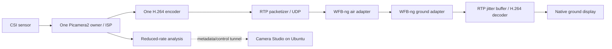

# Airborne video transport

## Decision and current implementation

Use **H.264 over RTP/UDP** as the video contract. Keep browser MJPEG for local configuration. Prepare a dedicated **WFB-ng** air/ground radio link once compatible USB adapters are available. This is an architecture choice for later hardware evaluation, not an installed radio stack or a range guarantee.

The repository implements synthetic RTP transmission, raw H.264 stdin packetization, a native ground receiver, conservative profiles and a read-only adapter/driver inventory. The loopback test actually encodes, packetizes, sends UDP, depacketizes and decodes video. It does not exercise RF or a Pi encoder.



The encoded-stream fanout from `engine.py` is **not integrated yet**. The current recording path and the transport bench are separate. Integrate a single encoded output with bounded branches for RTP and recording when the board returns; avoid a second capture owner or a second expensive software encode. Preserve clean video and transmit low-rate detection metadata separately. For a first RF test, disable the browser MJPEG viewer over the radio.

## Local bench

Install the host GStreamer packages listed in README. In separate terminals:

```bash
python3 airlink/video.py receive --profile bench
python3 airlink/video.py send-test --profile bench
```

Both default to 127.0.0.1:5600. Use `--headless` on receive without a display, or `--print-only` to inspect commands. For a LAN receiver, bind `--host` to its own private interface IP, and set sender `--host` to that address. No firewall settings are changed automatically. Stop with Ctrl-C.

An existing encoder can pipe an Annex-B H.264 byte stream into:

```bash
python3 airlink/video.py send-h264-stdin --host 127.0.0.1 --port 5600
```

The encoder must supply repeated IDRs and SPS/PPS, appropriate bitrate and dimensions. `send-h264-stdin` packetizes only; the profile does not reconfigure an upstream encoder. Do not launch `rpicam-vid` to supply it while Camera Studio owns the sensor.

Run the repeatable headless bench:

```bash
python3 -m unittest discover -s tests -p test_airlink.py -v
python3 airlink/diagnose.py
```

Observed loopback result: 29 decoded 640x360 frames from a 60-frame finite sender, with receive stopped after its configured buffer count. Receiver start/stop means this is a pipeline smoke test, not packet-loss estimation. Full sender/receiver E2E latency was not measured.

## Packet and queue contract

| Parameter | Initial value | Reason / limit |
| --- | --- | --- |
| Codec | H.264 | Native ground decode; camera encoding remains platform dependent |
| RTP payload / clock | 96 / 90000 Hz | Explicit caps at receiver |
| UDP port | 5600 | Local contract; configure WFB endpoints to match |
| RTP MTU | 1200 bytes | Candidate to avoid large IP packets; tune against actual radio MTU |
| IDR interval | One second in synthetic encoder | Candidate recovery tradeoff; measure after packet loss |
| SPS/PPS | `config-interval=-1` | Payloader sends with each IDR |
| Jitter buffer | 30 ms bench/Pi5, 40 ms Pi3 candidate | Bounded waiting, late packets dropped |
| Synthetic encoder | x264 ultrafast / zerolatency / no B frames | Host bench, not a Pi encoder selection |
| Bench | 640x360, 15 FPS, 1.5 Mbit/s | Low-load starting point |
| Pi 5 candidate | 1280x720, 30 FPS, 4 Mbit/s | Must be remeasured with radio + inference |

SPS/PPS behavior is documented by [GStreamer rtph264pay](https://gstreamer.freedesktop.org/documentation/rtp/rtph264pay.html). The [jitterbuffer](https://gstreamer.freedesktop.org/documentation/rtpmanager/rtpjitterbuffer.html) reorders packets, waits only up to its latency setting and adds that latency to the pipeline. A lower value is not automatically better on a variable radio channel.

## Radio software and drivers

WFB-ng maps video packets onto raw WiFi frames with forward error correction and authenticated encryption. It requires compatible injection/reception adapters and suitable drivers; ordinary managed WiFi is not equivalent. Consult the [upstream WFB-ng repository](https://github.com/svpcom/wfb-ng) and [setup guide](https://github.com/svpcom/wfb-ng/wiki/Setup-HOWTO) for the exact current hardware and build instructions.

The upstream project lists patched RTL8812AU and RTL8812EU driver paths. Match the **exact USB chipset, driver branch, Linux kernel, architecture and adapter power/thermal design** before installing a driver. A brand name or `lsusb` entry alone does not prove compatibility. Upstream driver projects: [rtl8812au](https://github.com/svpcom/rtl8812au) and [rtl8812eu](https://github.com/svpcom/rtl8812eu). No third-party kernel modules, blacklist rules, monitor-mode changes or TX-power overrides are installed by this project.

The current Ubuntu inventory has only Ethernet and loopback interfaces, with no wireless network interface. Its required GStreamer elements are available. `iw` and `ethtool` were not present in the inspected host environment. Once adapters arrive, install those OS tools as needed, rerun inventory, and validate WFB injection/RX against the exact kernel before changing the operational network. Keep SSH management on Ethernet during initial radio work.

[OpenHD](https://github.com/OpenHD/OpenHD) is an alternative integrated video/telemetry stack. Evaluate it as a separate image or documented external-video integration. Its camera capture service must not contend with this application's camera owner. Do not mix arbitrary OpenHD kernels/drivers with WFB packages without a compatibility plan.

Control and AI metadata should use a separately budgeted private IP tunnel or dedicated telemetry link. Do not stream the high-bandwidth HTTP MJPEG preview through that control tunnel. Wire encryption comes from a configured radio/tunnel stack, not from plain RTP/UDP or the camera's API token.

## Hardware acceptance sequence

1. Inventory both USB adapters, board OS/kernel and drivers; keep management Ethernet working.
2. Repeat the synthetic RTP bench through WFB with a physical link before attaching a camera stream.
3. Use the real Pi encoded stream with AI off. Verify stable decode, packet/FEC counters, CPU, temperature and power.
4. Introduce controlled obstruction/interruption; measure freeze duration and recovery at successive IDRs.
5. Add low-rate AI metadata, then onboard recording, checking that neither causes queue growth.
6. Measure optical latency using a timer/LED visible to the camera and the ground display. Report p50/p95 and methodology.
7. Progress from a bench to restrained outdoor tests with measured link margins, safe power and correct local RF configuration.

No range, control-link availability, flight readiness or driver compatibility is asserted by a localhost test. Automatic bitrate adaptation, retransmission, WebRTC, MAVLink overlays and flight-controller integration are future work.
