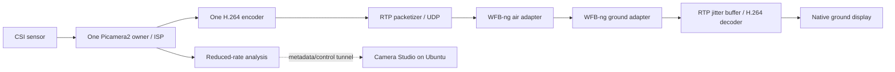

# Airborne video transport

## Decision and current implementation

Use **H.264 over RTP/UDP** as the video contract. Keep browser MJPEG for local configuration. Prepare a dedicated **WFB-ng** air/ground radio link once compatible USB adapters are available. This is an architecture choice for later hardware evaluation, not an installed radio stack or a range guarantee.

The repository implements real Pi camera H.264/RTP transmission, synthetic transmission, a native ground receiver, measured decoder monitoring, conservative profiles and a read-only adapter/driver inventory. Ethernet validation exercises the Pi encoder and actual host decoder. Radio hardware remains untested.



The Pi uses one camera owner and one H.264 encoder. `CameraOutputs` fans its encoded access units out to a nonblocking RTP sender and optional MP4 recorder. Starting/stopping either consumer preserves the other. Geometry, frame rate, HDR, rotation, bitrate, full-resolution capture and source changes are locked while encoding. Recording attached to an existing stream waits for the next IDR (up to about one second).

## Real camera over Ethernet

Start the receiver on the Ubuntu host:

```bash
python3 airlink/video.py receive --host YOUR_HOST_IPV4 --port 5600 --profile pi5-candidate
```

In Camera Studio select **Raspberry Pi**, open **Link**, enter that same receiver IPv4/port and click **Start RTP**. The browser remains an MJPEG configuration preview; the native receiver decodes H.264. The suggested receiver address comes from the host route to the explicitly selected Pi, without network scanning. Stop RTP before deploying or changing the encoding profile.

The sender accepts explicit private/loopback IPv4 unicast addresses, ports 1024–65535 and RTP MTUs 256–1400 bytes. It does not discover cameras or alter network interfaces. Restarting the camera service leaves RTP **off**; explicitly enable it again after recovery. Plain UDP provides no encryption, retransmission or delivery guarantee.

`RtpSender` implements Annex-B single-NAL and FU-A fragmentation according to [RFC 6184](https://www.rfc-editor.org/rfc/rfc6184). It repeats the encoder's SPS/PPS and one-second IDRs. Its bounded kernel socket queue drops rather than accumulating unlimited work. Status exposes sent bytes/packets/frames, local drops and errors. The bitrate counter includes RTP headers, but excludes UDP/IP and radio overhead. Native RTP is also accepted by the standard GStreamer depayloader in the automated interoperability test.

For quantitative headless monitoring, use the system Python with GI/GStreamer:

```bash
/usr/bin/python3 airlink/monitor.py --bind YOUR_HOST_IPV4 --port 5600 \
  --seconds 60 --output artifacts/receiver.json
python3 airlink/budget.py --help
python3 airlink/impair.py --help
```

Both receivers separate UDP reads from decoding through a leaky ingress queue bounded at 256 packets / 307200 bytes (no queue-time limit across idle gaps) and explicitly request a receive socket buffer. OS limits still apply; no system-wide buffer tuning is performed. The monitor stores aggregate measurements, never pixels. A private RTP extension (0xCD01, eight-byte Unix send timestamp) supports **encoder-output-to-decoded-frame** latency measurements, with before/after HTTP clock calibration and uncertainty. This excludes exposure, ISP, encoding and display. Standard receivers ignore the extension. A browser timer at `/latency-target` is provided for a later physical optical test; its precision is bounded by display refresh and browser scheduling. No optical result is inferred from software timestamps.

The bounded UDP relay can inject a repeatable blackout/loss into this stream without changing the NIC, firewall or another camera. See [real transport validation](RTP_VALIDATION_2026-11-03.md) for measured coexistence, interruption and recovery results.

## Local bench

Install the host GStreamer packages listed in README. In separate terminals:

```bash
python3 airlink/video.py receive --profile bench
python3 airlink/video.py send-test --profile bench
```

Both default to 127.0.0.1:5600. Use `--headless` on receive without a display, or `--print-only` to inspect commands. For a LAN receiver, bind `--host` to its own private interface IP, and set sender `--host` to that address. No firewall settings are changed automatically. Stop with Ctrl-C.

An existing encoder can pipe an Annex-B H.264 byte stream into:

```bash
python3 airlink/video.py send-h264-stdin --host 127.0.0.1 --port 5600
```

The encoder must supply repeated IDRs and SPS/PPS, appropriate bitrate and dimensions. `send-h264-stdin` packetizes only; the profile does not reconfigure an upstream encoder. Do not launch `rpicam-vid` to supply it while Camera Studio owns the sensor.

Run the repeatable headless bench:

```bash
python3 -m unittest discover -s tests -p test_airlink.py -v
python3 airlink/diagnose.py
```

Observed loopback result: 29 decoded 640x360 frames from a 60-frame finite sender, with receive stopped after its configured buffer count. Receiver start/stop means this is a pipeline smoke test, not packet-loss estimation. Full sender/receiver E2E latency was not measured.

## Packet and queue contract

| Parameter | Initial value | Reason / limit |
| --- | --- | --- |
| Codec | H.264 | Native ground decode; camera encoding remains platform dependent |
| RTP payload / clock | 96 / 90000 Hz | Explicit caps at receiver |
| UDP port | 5600 | Local contract; configure WFB endpoints to match |
| RTP MTU | 1200 bytes | Candidate to avoid large IP packets; tune against actual radio MTU |
| IDR interval | One second in Pi and synthetic encoders | Candidate recovery tradeoff; measure after packet loss |
| SPS/PPS | Repeated encoder headers / `config-interval=-1` | Pi / synthetic sender respectively |
| Jitter buffer | 30 ms bench/Pi5, 40 ms Pi3 candidate | Bounded waiting, late packets dropped |
| Synthetic encoder | x264 ultrafast / zerolatency / no B frames | Host bench, not a Pi encoder selection |
| Bench | 640x360, 15 FPS, 1.5 Mbit/s | Low-load starting point |
| Pi 5 candidate | 1280x720, 30 FPS, 4 Mbit/s | Must be remeasured with radio + inference |

SPS/PPS behavior is documented by [GStreamer rtph264pay](https://gstreamer.freedesktop.org/documentation/rtp/rtph264pay.html). The [jitterbuffer](https://gstreamer.freedesktop.org/documentation/rtpmanager/rtpjitterbuffer.html) reorders packets, waits only up to its latency setting and adds that latency to the pipeline. A lower value is not automatically better on a variable radio channel.

## Payload budget

At 4 Mbit/s video, MTU 1200, an illustrative 12/8 FEC ratio and 64 kbit/s control reserve, `airlink/budget.py` estimates approximately **6.34 Mbit/s** of payload capacity before unmodeled radio/MAC/security/FEC-block headers, bitrate bursts and fading margin. The FEC ratio is a calculation input, not an installed or validated radio configuration. Enter measured usable payload capacity, never the advertised PHY link rate.

## Radio software and drivers

WFB-ng maps video packets onto raw WiFi frames with forward error correction and authenticated encryption. It requires compatible injection/reception adapters and suitable drivers; ordinary managed WiFi is not equivalent. Consult the [upstream WFB-ng repository](https://github.com/svpcom/wfb-ng) and [setup guide](https://github.com/svpcom/wfb-ng/wiki/Setup-HOWTO) for the exact current hardware and build instructions.

The upstream project lists patched RTL8812AU and RTL8812EU driver paths. Match the **exact USB chipset, driver branch, Linux kernel, architecture and adapter power/thermal design** before installing a driver. A brand name or `lsusb` entry alone does not prove compatibility. Upstream driver projects: [rtl8812au](https://github.com/svpcom/rtl8812au) and [rtl8812eu](https://github.com/svpcom/rtl8812eu). No third-party kernel modules, blacklist rules, monitor-mode changes or TX-power overrides are installed by this project.

The current Ubuntu inventory has only Ethernet and loopback interfaces, with no wireless network interface. Its required GStreamer elements are available. `iw` and `ethtool` were not present in the inspected host environment. Once adapters arrive, install those OS tools as needed, rerun inventory, and validate WFB injection/RX against the exact kernel before changing the operational network. Keep SSH management on Ethernet during initial radio work.

[OpenHD](https://github.com/OpenHD/OpenHD) is an alternative integrated video/telemetry stack. Evaluate it as a separate image or documented external-video integration. Its camera capture service must not contend with this application's camera owner. Do not mix arbitrary OpenHD kernels/drivers with WFB packages without a compatibility plan.

Control and AI metadata should use a separately budgeted private IP tunnel or dedicated telemetry link. Do not stream the high-bandwidth HTTP MJPEG preview through that control tunnel. Wire encryption comes from a configured radio/tunnel stack, not from plain RTP/UDP or the camera's API token.

## Hardware acceptance sequence

1. Inventory both USB adapters, board OS/kernel and drivers; keep management Ethernet working.
2. Repeat the synthetic RTP bench through WFB with a physical link before attaching a camera stream.
3. Use the real Pi encoded stream with AI off. Verify stable decode, packet/FEC counters, CPU, temperature and power.
4. Introduce controlled obstruction/interruption; measure freeze duration and recovery at successive IDRs.
5. Add low-rate AI metadata, then onboard recording, checking that neither causes queue growth.
6. Measure optical latency using a timer/LED visible to the camera and the ground display. Report p50/p95 and methodology.
7. Progress from a bench to restrained outdoor tests with measured link margins, safe power and correct local RF configuration.

No range, control-link availability, flight readiness or driver compatibility is asserted by a localhost test. Automatic bitrate adaptation, retransmission, WebRTC, MAVLink overlays and flight-controller integration are future work.
