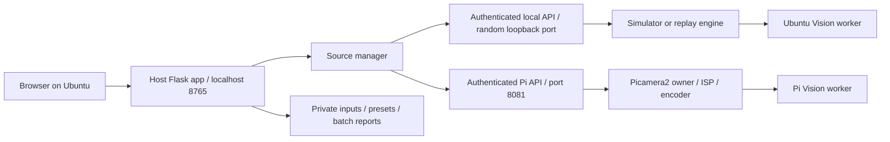

# Architecture and API

## Execution boundaries



`host.py` owns the browser application and proxies a selected endpoint. `host_services.py` manages source selection, presets, profiles and the offline API. `camera_api.py` is the common authenticated contract. `backend.py` lazily imports the Pi engine, so host imports do not need camera drivers.

`configuration.py` supplies shared validation. `engine.py` owns physical camera commands, capture, encoding, analysis and watchdog recovery. `offline.py` owns software capture/replay and uses the same API. Its capture and vision loops are independent; latest frames replace older analysis work. `vision.py` implements CPU algorithms and normalized boxes. `recording.py` uses a bounded four-frame host encoder queue, with drop/error counters. `benchmark.py` processes a bounded file job with separate Vision state.

The physical engine remains a single camera owner. Do not start a second Picamera2/rpicam/OpenHD capture process alongside it. The backend fans one encoder output into recording and RTP through `encoded_outputs.py`. `rtp.py` packetizes existing H.264 bytes and sends through a bounded nonblocking socket; it never acquires the sensor. The standalone transport tools also accept synthetic or already encoded video.

## API contract

Host at localhost:8765; Pi camera API at private-address:8081. POSTs to the host need `X-Camera-Client: 1`. Calls directly to a camera API need `X-Camera-Token: <private token>`. Browser requests never receive the token. Camera JSON payload limit: 16 KB. Host uploads: 512 MB.

| Endpoint | Method | Purpose |
| --- | --- | --- |
| `/api/health` | GET | Host version and selected source, no hardware probe |
| `/api/host` | GET | Mode, input library and profiles |
| `/api/source` | POST | `{mode, input_id?, camera_url?}`; mode simulator/replay/pi |
| `/api/inputs` | GET / POST | List inputs / multipart field `file` |
| `/api/playback` | POST | `{paused?, seek_s?}` for replay |
| `/api/status` | GET | Settings, metadata, capabilities, analysis, recording, rates, events |
| `/stream.mjpg` | GET | Multipart JPEG preview |
| `/api/frame.jpg` | GET | Latest preview JPEG |
| `/api/settings` | POST | Validated partial camera settings |
| `/api/transport` | POST | `{enabled:true,host,port?,mtu?}` or `{enabled:false}`; real Pi only |
| `/api/clock` | GET | Unix/monotonic nanoseconds for software clock calibration |
| `/latency-target` | GET | Host browser optical-test timer, no automatic latency result |
| `/api/ai` | POST | objects/faces/qr/motion booleans, confidence, interval_ms |
| `/api/track` | POST | `{roi:{x,y,w,h}}` normalized coordinates; null clears |
| `/api/action/<name>` | POST | snapshot, snapshot_full, record_start, record_stop, restart, autofocus |
| `/api/media` | GET | Current source's media list |
| `/api/media/<name>` | GET | Download finished media/sidecars |
| `/api/media/view/<name>` | GET | Host inline media, Range support |
| `/api/presets` | GET / POST | List / save current `{name}` or import `{preset}` |
| `/api/presets/<id>` | GET | Export portable JSON |
| `/api/presets/<id>/apply` | POST | Apply validated preset |
| `/api/profiles/<id>/apply` | POST | Apply built-in profile |
| `/api/benchmarks` | GET / POST | Reports/progress / start input analysis |
| `/api/reports/<id>.json` or `.csv` | GET | Download a completed host report |

Host-only endpoints are not implemented on the Pi. Examples:

```bash
curl http://127.0.0.1:8765/api/status
curl -H 'X-Camera-Client: 1' -H 'Content-Type: application/json' \
  -d '{"mode":"simulator"}' http://127.0.0.1:8765/api/source
curl -H 'X-Camera-Client: 1' -H 'Content-Type: application/json' \
  -d '{"qr":true,"interval_ms":350}' http://127.0.0.1:8765/api/ai
```

Validation rejects unknown keys, nonfinite values, wrong types and invalid ranges. Complete resolution pairs are checked against 640x360, 1280x720 and 1920x1080. Host presets use `format: camera-studio-preset`, `version: 1`, name, camera object and optional analysis object. Applying a preset filters unsupported physical settings in offline mode, then applies camera and AI values; camera settings are rolled back if AI application fails.

## Private storage

- `camera_app/runtime.json`: shared token + Pi URL, mode 0600.
- `host-data/session.json`: selected source; no automatic network discovery.
- `host-data/inputs/`: UUID filenames + probed index; imported videos remain private.
- `host-data/presets.json`: named host presets.
- `host-data/offline/`: software settings and analysis; `media/` contains JPEG/MP4/JSON/JSONL and encoder logs.
- `host-data/reports/`: analysis JSON/CSV, potentially including input names and QR contents.
- Pi `~/camera_app/data/`: physical settings, media and metadata.

JSON state writes use unique temporary files, fsync and atomic replacement. There is no automatic retention/deletion policy. Keep reports private when inputs or QR content are private. A single host process owns each data directory; multiple independent writers are not supported.

## Trust and deployment limits

The host listens only on loopback. Its write header limits ordinary cross-site form writes but is not a multiuser authentication system. Camera URLs are restricted to private/loopback IPs or `.local` names without credentials or paths. The Pi listens on its network interfaces and uses token authentication over plain HTTP. Use a trusted development LAN or an encrypted private tunnel; do not expose port 8081 publicly. TLS, Internet auth, discovery and role-based access are outside this version.

A source change closes the old stream generation and reconnects the preview. Failures remain attributed to the selected source. No GigE Vision discovery, address reassignment or NIC reconfiguration is performed.
