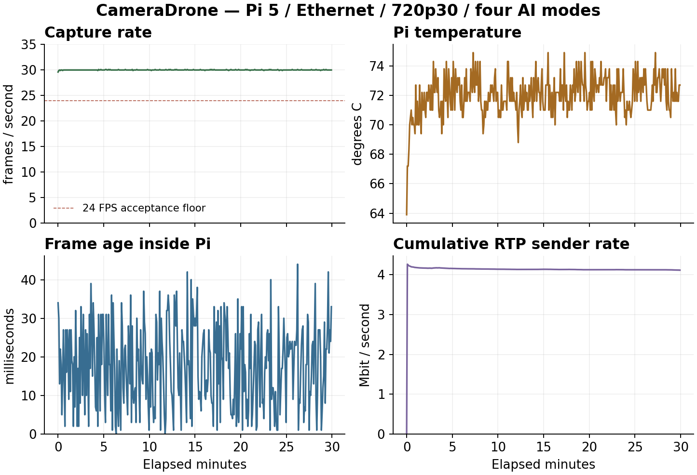

# Real camera transport validation — 3 November 2026

## Scope and platform

Release 0.3 adds one-encoder H.264 recording/RTP fanout to the real Picamera2 backend. Testing used Raspberry Pi 5 (8 GB), CSI IMX708, Ethernet and the Ubuntu host's standard GStreamer H.264 decoder. No GigE Vision camera, WiFi interface, radio driver, bootloader or EEPROM was modified. Private raw logs and camera media remain outside the public repository.

The Pi ran Debian 13.7, kernel 6.18.50+rpt-rpi-2712, Python 3.13.5, Picamera2 0.3.37 and OpenCV 4.10.0. The Ubuntu decoder used GStreamer 1.20.3. `tools/environment.py` exports nonsecret package/source hashes for local reproduction.

## Functional transport checks

| Check | Measured result |
| --- | --- |
| Initial real RTP decode | 115 decoded 1280x720 frames; 30.169 FPS; no loss |
| RTP plus recording | 594 decoded frames over approximately 20 seconds; 30.048 FPS; no decode errors or packet loss |
| Shared encoder | Encoder generation unchanged when attaching/stopping recording; stopping RTP preserved a concurrent recording |
| MP4 coexistence | Six-second recording decoded strictly with FFmpeg; complete file, no decode errors |
| Controlled interruption | Bounded UDP relay dropped packets during a two-second blackout; decoder recovered without restart |
| Blackout observation | 567 frames in 24.316 seconds, maximum decoded-frame gap 2621.387 ms; receiver reported 911 lost packets, matching relay drops |
| Service restart | Recording finalized (161 decoded frames, zero errors); service returned in 4.15 seconds |
| RTP after service restart | Sender stayed off until explicitly enabled; existing receiver accepted the new RTP session; maximum decode gap 4926.603 ms |
| Provisioning check | Read-only Pi OS/module/FFmpeg checks passed on the actual board |
| Software reboot | Boot identity changed; API returned in 32.23 seconds, before post-boot SSH; capture 30 FPS, settings/AI preserved, RTP off |
| Final functional regression | 18 camera checks and six transport lifecycle/guard checks passed |
| Corrected-run recording | First-minute MP4 decoded to 1802 frames on Ubuntu, EOS reached, no errors/warnings; GStreamer avdec_h264 with max-errors=0 and output-corrupt=false |

The relay test changes only its own UDP forwarding. It is not an RF fading/FEC test. A successful recovered stream can still contain a visible freeze. Maximum decoded-frame gap is reported separately from average FPS and timestamp latency.

## Initial extended run: retained failure

The first long run was deliberately stopped after **1147.368 seconds** when a stability failure appeared. It decoded 32419 frames at 28.294 FPS, but reported **487 lost RTP packets** and a **17041.321 ms** maximum decode gap. Pi capture/encoding continued at approximately 30 FPS with no local sender drops. Linux reported 457 receive-buffer drops on this receiver socket; this is a host socket counter, not an RF measurement.

The original receive path used the default 212992-byte kernel buffer and ran decoder/measurement callbacks directly downstream of the network reader. The revised monitor and native receiver request a bounded socket buffer and add a bounded, leaky ingress queue (256 packets or 307200 bytes; whichever limit is reached first). This separates network reads from downstream stalls and discards stale backlog. No global sysctl, NIC, firewall or driver settings were changed. [GStreamer documents the socket buffer setting and OS limits](https://gstreamer.freedesktop.org/documentation/udp/udpsrc.html).

This observation motivates the receiver change; it does not prove that every missing packet had the same cause. The failed run remains separate from subsequent validation. Average FPS and median software latency alone did not establish stable delivery.

## Corrected 30-minute run: passed

The fresh run completed with four CPU AI/CV modes every 350 ms, two JPEG preview clients, 720p30 RTP and the first minute recorded. All acceptance assertions passed; one encoder generation was preserved throughout.

| Observation | Result |
| --- | --- |
| Controller run duration | 1802.76 seconds |
| Receiver duration | 1803.125 seconds |
| Decoded frames / rate | 54071 / 30.014 FPS |
| Capture minimum, including startup | 29.6 FPS |
| Capture minimum after first 10 seconds | 29.9 FPS |
| Receiver RTP packets | 803104 |
| Receiver bytes | 927445056 |
| Lost / late / duplicate RTP packets | 0 / 0 / 0 |
| Decoder errors / warnings | 0 / 0 |
| Maximum decoded-frame gap | 78.651 ms |
| Maximum sampled Pi temperature | 74.9 C |
| Maximum sampled internal frame age | 44 ms |
| Current firmware thermal flags observed | 0 throughout |
| Local sender drops / malformed frames | 0 / 0 |
| Recorded MP4 | 1802 decoded frames; complete EOS, zero decoder errors/warnings |

The revised receiver socket used an effective 425984-byte receive buffer on this Ubuntu host, with zero socket-buffer drops in sampled `ss` observations. No global kernel buffer tuning was applied. This is an Ethernet acceptance result, not a guarantee for RF or every host workload.

The long run's raw timestamp estimates are **not usable as latency**: clock offset changed by 62.982 ms, exceeding the combined 7.897 ms calibration uncertainty; the raw median was negative. This run validates decode continuity, packet delivery and Pi workload stability. A separate short, clock-qualified measurement is reported below. The public aggregate plot excludes timestamp latency.



## Clock validity and candidate profile

Immediately after reboot, the 18.275-second Pi3 candidate-profile check on Pi5 decoded **235 frames at 15.017 FPS**, 640x360, with zero reported packet loss/errors and an 88.368 ms maximum gap. This validates profile behavior on Pi5 only. Its clocks changed offset by **227.056 ms** during the run, so its negative software latency estimates are invalid and must not be used.

The monitor now rejects latency summaries when before/after clock offset changes exceed combined calibration uncertainty, or when the median estimate is negative. It reports null latency quantiles, a reason and explicitly raw timestamp estimates. Two unit tests cover valid clocks and rejection of drift/negative/missing measurements. Decoder counts/gaps/loss remain independent of clock validity.

## Software latency method

The RTP sender stamps each encoded access unit after encoding using an eight-byte Unix timestamp in a private RTP extension. The host maps that timestamp through its jitter/depay/decode pipeline to the decoded RGB frame. Eight HTTP clock samples before/after the run select the smallest-roundtrip estimate and report half-roundtrip uncertainty and observed offset drift.

The coexistence run measured p50 **13.892 ms**, p95 **22.587 ms** from encoder output to host decoded frame. Initial clock uncertainty was several milliseconds (approximately 2.9–5.2 ms in the short first run). These numbers exclude exposure, sensor readout, ISP, H.264 encoding, display queues and monitor refresh. They are **not optical end-to-end latency** and should not be compared directly with glass-to-glass measurements.

`/latency-target` supplies a changing browser timer for a later physical test. It neither measures latency automatically nor overcomes refresh/scheduling limitations. No optical result is claimed.

## Additional relay regression: retained failures

The first final relay check decoded 241 frames and observed a 5032.706 ms maximum gap; its receiver reported 1052 lost packets while the relay intentionally dropped 915. It failed acceptance. The relay still used a default receive buffer, so the relay was updated to request 212992 bytes (425984 effective on this host) and report Linux `SO_RXQ_OVFL` counters.

The next run recovered with **607 frames**, a **2318.179 ms** maximum gap and no decoder errors/warnings. Relay receive/send drops were zero. However, the strict loss-accounting assertion still failed: the receiver reported **933 lost packets** against **932 intentional relay drops**. That one additional loss was not attributed; the run is retained as a failed strict accounting check, even though picture recovery succeeded. It does not invalidate the separate direct Ethernet soak's zero-loss result.

## Final interruption fix and accounting

A confirmation with an independent RTP input sequence counter reproduced the one extra gap (938 input gaps against 937 intentional drops, no reordering/duplicates). This ruled out a discrepancy confined to the jitterbuffer statistic. Removing the ingress queue's **time** limit, while retaining its packet and byte limits, eliminated that extra gap in the targeted check. The initial queue's elapsed-time accounting across a blackout was therefore implicated; the test's exact loss-accounting assertion was retained.

The final controlled-blackout test passed: **637 decoded frames**, maximum gap **2309.399 ms**, **951 intentional relay drops = 951 observed input sequence gaps = 951 jitterbuffer lost packets**, zero relay receive/send drops and zero decoder errors/warnings. The decoder recovered without restart. The queue remains leaky and bounded at 256 packets / 307200 bytes; `max-size-time=0` prevents the idle interval itself from acting as queue occupancy. Jitter waiting remains bounded at 30 ms.

The earlier 30-minute direct soak used the initial 100 ms queue-time limit. The final queue change targets interruption handling; a separate direct minute-long regression covers the final configuration. Capture, Pi encoding and the successful direct-run results are preserved. A physical RF interruption is still untested.

The sequence diagnostic records forward gaps separately from reorders and duplicates. Later reordered arrivals do not subtract earlier forward gaps; interpret them as missing packets only in an ordered test such as this one. GStreamer remains responsible for runtime RTP reordering.

## Final direct regression after the queue fix

A final **62.80-second** controller run exercised the final queue configuration, all four AI modes, direct RTP and ten seconds of concurrent recording. It passed all assertions: **1851 decoded frames / 29.578 FPS**, capture minimum **29.9 FPS**, zero input sequence gaps/reordering/duplicates, zero jitterbuffer lost/late packets and zero decoder errors/warnings. Maximum temperature was **72.7 C**, internal frame age **27 ms**, one encoder generation throughout.

The maximum decoded-frame gap was **969.520 ms**, below the test's 1500 ms acceptance limit, but substantially worse than the longer run's 78.651 ms. This test included recording start/stop; the exact cause of the short pause was not profiled. Do not infer uninterrupted low-latency delivery from the median alone. A strict real-time application still needs profiling of capture/record-finalization stalls and its own tighter acceptance budget.

Clock-qualified software latency was **p50 11.125 ms / p95 22.404 ms**, with **0.128 ms** observed offset drift and before/after uncertainties **3.266 / 3.793 ms**. This excludes the same exposure/ISP/encoding/display stages as all other software timestamp measurements.

## Final browser and clock-qualified check

The host browser's **Start RTP** and **Stop RTP** controls were exercised against the real board. Start locked incompatible controls and began sending; Stop released them. The receiver decoded **393 frames at 30.103 FPS**, zero loss/errors/warnings, with a 73.430 ms maximum gap. Its 25.083-second process duration includes waiting for the manual browser start; the 11.950-second first-frame time is not a camera startup benchmark.

This short check passed clock qualification: offset changed by **0.495 ms**, with before/after uncertainties **2.689 / 3.114 ms**. Encoder-output-to-decoded-frame latency was **p50 11.042 ms, p95 23.654 ms**. All four AI modes remained enabled. These are software transport/decode estimates with millisecond clock uncertainty; exposure, ISP, encoding and display remain excluded.

## Reproduce

Run host unit tests without the board:

```bash
python3 -m unittest discover -s tests -p 'test_*.py' -v
```

The suite has 19 tests, including wire-level FU-A reconstruction, sequence wrap/marker/timestamp validation, address boundaries, and the custom sender decoded by standard GStreamer. Synthetic test media are generated locally.

With the real Pi deliberately selected and no recording/RTP session active:

```bash
/usr/bin/python3 tests/transport_soak.py --seconds 1800 --record-seconds 60
python3 tests/hardware_check.py
/usr/bin/python3 tests/transport_recovery.py
```

The aggregate plot can be regenerated with distribution Matplotlib (optional documentation dependency):

```bash
python3 tools/plot_transport_report.py artifacts/YOUR_PREFIX-results.json \
  --output artifacts/transport-metrics.png
```

The plot includes only capture rate, temperature, internal frame age and cumulative RTP byte rate. It contains no camera imagery, addresses or runtime secrets. Capture/frame-age samples are polled approximately every five seconds; a brief event between polls can be missed. Receiver gap/loss measurements are tracked separately at every decoded frame/packet.

These hardware scripts change settings and create private media. The transport soak enables four CPU AI/CV modes every 350 ms, previews JPEG, sends 720p30 H.264 over RTP and records the first minute. It verifies one encoder generation, steady capture/decoded rates above 24 FPS, zero reported packet loss/local drops, and a maximum decode gap below 1500 ms. It restores previous settings/analysis afterward. Receiver measurements and errors are retained even when assertions fail.

## Remaining physical acceptance

Actual radio adapters, driver/kernel matching, RF capacity/FEC, range, interference, optical latency, cold boot after power removal, Pi 3 A+ memory/hardware encoding, power quality and long-duration 1080p remain unverified. The approximate budget tool is not a PHY-rate or range predictor. Clean shutdown is not protection against abrupt power loss.
